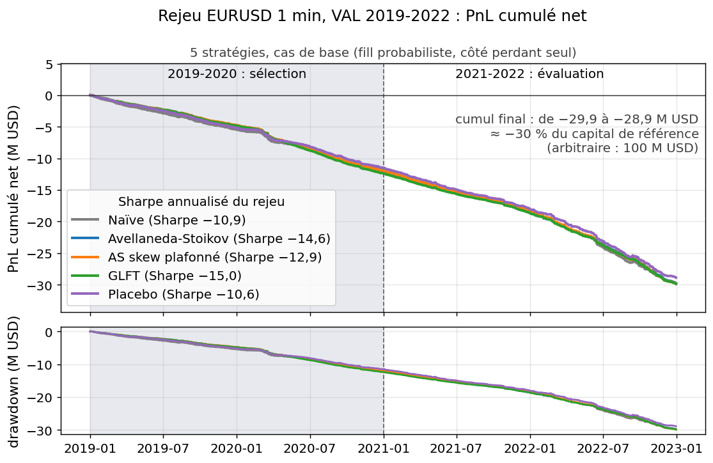
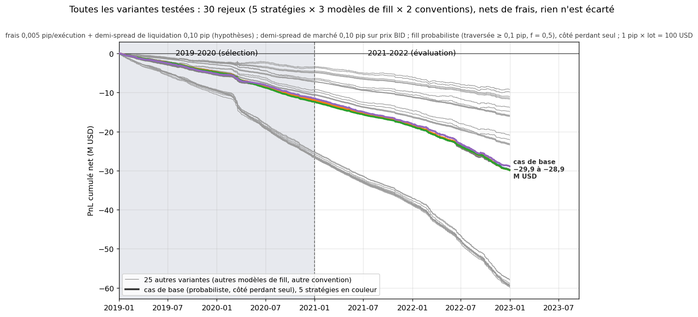
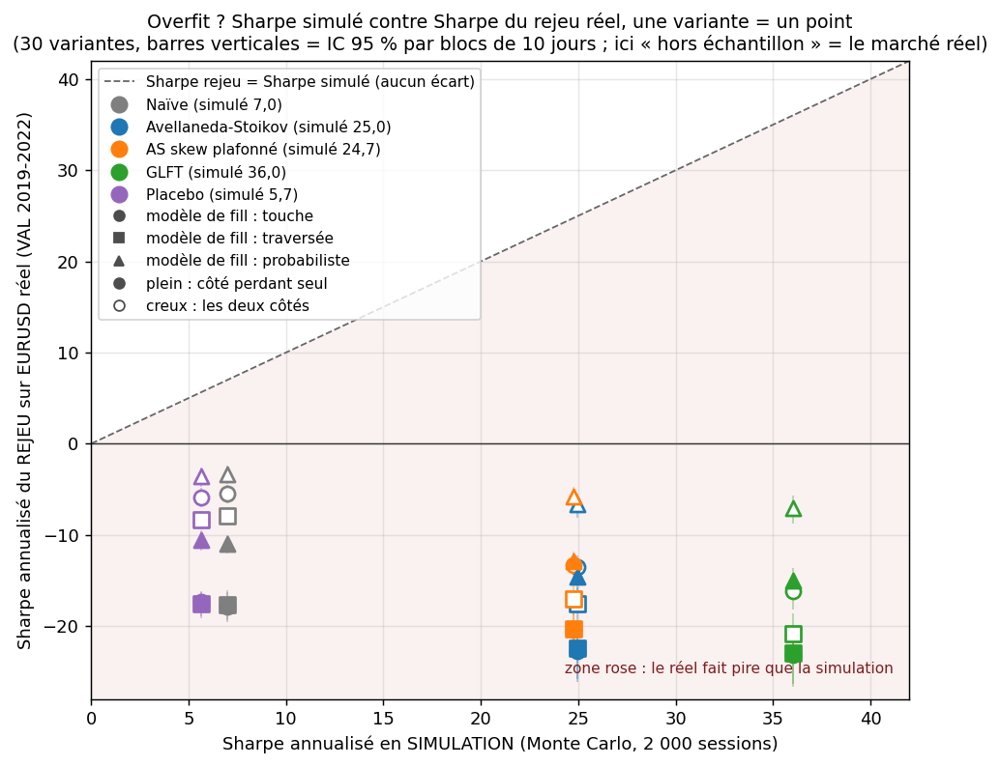

<!-- Fichier généré par scripts/generer_readme.py à partir de scripts/modele_readme.md : éditer le modèle, pas ce fichier. -->
# Market making FX : le Sharpe simulé est une borne haute, pas un Sharpe de marché

Simulateur de market making EURUSD (Avellaneda-Stoikov, GLFT, naïf, placebo) à noyau numba et Monte Carlo à tirages communs, comparé à un rejeu sur quatre ans de barres 1 minute réelles pour montrer d'où vient le PnL d'un market maker et quelle part n'est qu'un artefact du simulateur.

- **At a glance.** FX market-making simulator (Avellaneda-Stoikov, GLFT, naive quotes, random-quote placebo): numba core, Monte Carlo with common random numbers, replay on four years of real EURUSD 1-minute bars (30 variants, test set sealed).
- **Result.** Simulated annualised Sharpe from +5.7 to +36.0, valid only inside the model's own world; the replay is negative for all 30 variants (-23.2 to -3.4) and a driftless random-walk control gives losses of the same order, so the replay measures the fill convention, not the market.
- **Limits.** A, k, p and α are assumptions (no order data); 1-minute bars imply about 60 s of quote latency; no L2 book; the "loser side" fill rule uses the bar's close, a pessimistic choice made after the fact.

[](https://github.com/yassine-ek/fx-market-making-simulator/actions/workflows/tests.yml)  

## Résultats clés

<!-- AUTO:CLES -->
- **Simulation (Monte Carlo, 2 000 sessions)** : Sharpe annualisé de **+5,7** (placebo) à **+36,0** (GLFT asymptotique). *Réserve : le monde simulé obéit au modèle testé, l'espérance y est donc positive par construction (même des cotes tirées au hasard gagnent) : c'est une borne haute, pas un Sharpe de marché.*
- **Rejeu sur EURUSD 1 minute réel (VAL 2019-2022, 30 variantes)** : Sharpe de **-23,2 à -3,4** ; cas de base d'Avellaneda-Stoikov : **-29,8 M USD** de PnL cumulé, soit ≈ -30 % d'un capital de référence arbitraire de 100 M USD (aucun PnL réel). *Réserve : une marche aléatoire sans dérive donne le même ordre de perte (stratégie naïve, pips × lot par jour : -359 sur marche aléatoire, -287 sur barres réelles) : le rejeu mesure surtout la convention de remplissage (côté perdant choisi avec le close de la barre, pessimiste a posteriori), pas le marché.*
- **Ce que le projet établit** : en simulation (balayage de latence, 500 sessions par cellule), le Sharpe d'Avellaneda-Stoikov passe de **+25,3 à 100 ms de latence à -3,2 à 1 s**, et une barre de 1 minute équivaut à 60 s de latence (-99,2 dans le simulateur) : le rejeu ne contredit donc pas le simulateur, il tombe dans sa zone d'effondrement. *Réserve : A, k, p et α sont des hypothèses, pas des mesures (aucune donnée d'ordres) ; c'est une sensibilité, pas une performance.*
<!-- /AUTO:CLES -->



*Rejeu sur EURUSD 1 minute réel (2019-2022), net de frais, cinq stratégies, cas de base ; drawdown en dessous. Échelle : 1 M USD = 1 % d'un capital de référence arbitraire de 100 M USD. Les cinq courbes se superposent et descendent régulièrement : la perte ne vient pas d'une période mais de la convention de fill (contrôle marche aléatoire plus bas).*

**Liens** : [tableau de bord interactif](https://yassine-ek.github.io/fx-market-making-simulator/) · [notebook guidé](notebooks/visite_guidee.ipynb) · [détails : méthode, résultats, tests](docs/details.md) · [reproduire](#reproduire)

<!-- AUTO:TETE -->
## Frais et hypothèses

- **Frais** : 0,005 pip par exécution (≈ 0,5 USD par million : ordre de grandeur, non vérifié) + liquidation de l'inventaire résiduel en fin de session (demi-spread de marché 0,10 pip × lots détenus). Tous les PnL sont **NETS** de ces deux coûts ; 1 pip × 1 lot (1 M EUR) = 100 USD.
- **Hypothèses, pas des mesures** (aucune donnée d'ordres) : A = 0,10 /s, k = 6,0 /pip, p = 0,20, α = 0,30 pip. Elles pilotent la simulation, pas le rejeu ([tableau complet](docs/details.md#frais-et-hypothèses)).
- **Données** : EURUSD 1 minute HistData (prix BID, heure de New York), session 03h-12h, 1 036 journées de rejeu (2019-01-02 → 2022-12-30) ; non redistribuées.
- **Découpage** : TRAIN ≤ 2018 (calibration de σ seulement) · VAL 2019-2022 (rejeu) · TEST 2023+ scellé, jamais lu (`PermissionError` testé).
- **Latence et remplissage** : la cote de la minute *i* repose sur le close de *i*-1 (**60 s de latence implicite**) ; 3 modèles de fill × 2 lectures de « bid ET ask touchés » (cas de base : probabiliste + côté perdant seul, un choix pessimiste a posteriori : voir Limites).
- **Statistiques** : Sharpe journalier × √252 ; IC 95 % par bootstrap (blocs de 10 jours pour le rejeu) ; PSR et DSR sur les 30 variantes.

## Métriques par stratégie : simulation et rejeu réel côte à côte

Équivalent ici du « TRAIN | VAL » d'un projet de stratégie : à gauche le monde **simulé** (les hypothèses du modèle sont vraies par construction), à droite le **rejeu sur EURUSD réel** VAL 2019-2022 (cas de base : probabiliste, côté perdant seul). PnL en pips × lot par journée. Les deux Sharpe ne sont pas comparables (mondes différents) : on ne les divise pas.

| Stratégie | Sharpe simulé [IC95] | Sharpe rejeu VAL net [IC95] | PnL moyen/jour simulé | PnL moyen/jour rejeu | Exéc./jour simulé | Exéc./jour rejeu |
|---|---|---|---|---|---|---|
| Naïve symétrique | 7,0 [6,3 ; 7,8] | -10,9 [-12,0 ; -10,0] | 298 | -287 | 2 325 | 267 |
| Avellaneda-Stoikov | 25,0 [23,9 ; 26,0] | -14,6 [-16,1 ; -13,2] | 302 | -287 | 2 319 | 267 |
| AS skew plafonné | 24,7 [23,7 ; 25,8] | -12,9 [-14,2 ; -11,8] | 303 | -288 | 2 315 | 268 |
| GLFT asymptotique | 36,0 [34,8 ; 37,3] | -15,0 [-16,5 ; -13,7] | 306 | -288 | 2 320 | 267 |
| Placebo (cotes aléatoires) | 5,7 [5,0 ; 6,4] | -10,6 [-11,7 ; -9,5] | 246 | -279 | 2 637 | 266 |

*IC95 du rejeu : bootstrap par blocs de 10 jours.*

<details>
<summary>Rejeu VAL, cas de base : pertes en M USD avec leur échelle, drawdown, frais, markout, PSR/DSR (9 colonnes)</summary>

**Rejeu VAL, cas de base : pertes, drawdown, frais payés et significativité.**

*Échelle : le « % » est le PnL en M USD rapporté à un capital de référence **arbitraire** de 100 M USD (il ne change pas le Sharpe et ne représente aucun PnL réel).*

| Stratégie | PnL cumulé 2019-2022, M USD (% du capital de réf.) | Drawdown max, M USD (% du capital de réf.) | Jours gagnants | Frais + liquidation payés / jour (pips × lot) | Markout +1 min, côté perdant (pip) | Markout +1 min, deux côtés (pip) | PSR(0) | DSR (30 essais) |
|---|---|---|---|---|---|---|---|---|
| Naïve symétrique | -29,8 (≈ -30 %) | -29,8 (≈ -30 %) | 17,8 % | 2,3 | -1,10 | -0,27 | < 0,001 | < 0,001 |
| Avellaneda-Stoikov | -29,8 (≈ -30 %) | -29,8 (≈ -30 %) | 6,7 % | 2,1 | -1,10 | -0,28 | < 0,001 | < 0,001 |
| AS skew plafonné | -29,8 (≈ -30 %) | -29,9 (≈ -30 %) | 9,5 % | 2,1 | -1,09 | -0,27 | < 0,001 | < 0,001 |
| GLFT asymptotique | -29,9 (≈ -30 %) | -29,9 (≈ -30 %) | 6,5 % | 1,9 | -1,10 | -0,28 | < 0,001 | < 0,001 |
| Placebo (cotes aléatoires) | -28,9 (≈ -29 %) | -28,9 (≈ -29 %) | 18,1 % | 2,3 | -1,09 | -0,29 | < 0,001 | < 0,001 |

*Drawdown = pire baisse du PnL cumulé depuis son sommet (le PnL décroît presque en continu : drawdown ≈ perte totale). Markout = (mid futur − prix d'exécution) × sens, par exécution. Les frais et la liquidation (quelques pips × lot par jour) ne sont pas la cause de la perte : la convention de fill l'est (contrôle marche aléatoire dans les détails). PSR(0) = 0 et DSR = 0 quand tous les Sharpe sont négatifs : ces colonnes n'apportent aucune information de plus.*

</details>

**Verdict.** Aucune des 30 variantes du rejeu n'a un Sharpe positif (de -23,2 à -3,4) alors que la simulation donnait +5,7 à +36,0. Mais le même rejeu sur 400 journées de marche aléatoire sans dérive donne un PnL du même ordre : le rejeu mesure le coût de la convention de fill sur barres de 1 minute, pas une propriété du marché réel. Le Sharpe simulé est une **borne haute**, pas un Sharpe de marché. TEST scellé.
<!-- /AUTO:TETE -->

<!-- AUTO:OVERFIT -->
## Overfit ou pas ? Lecture en 30 secondes

1. **Simulation contre marché réel : le Sharpe change de signe.** Sharpe simulé → Sharpe du rejeu (cas de base) : Naïve symétrique 7,0 → -10,9, Avellaneda-Stoikov 25,0 → -14,6, AS skew plafonné 24,7 → -12,9, GLFT asymptotique 36,0 → -15,0, Placebo (cotes aléatoires) 5,7 → -10,6. Les 30 variantes du rejeu sont toutes négatives. Ce n'est pas un overfit au sens classique (rien n'a été ajusté sur la simulation : tous les paramètres sont fixés a priori) mais un écart de monde : le Sharpe simulé est une borne haute.
2. **Le placebo (cotes aléatoires) fait aussi bien qu'Avellaneda-Stoikov.** Dans le rejeu, PnL moyen par jour de -288 (AS) contre -279 (placebo), côté perdant seul ; AS fait mieux dans 13 % des 30 graines seulement. La logique d'inventaire n'apporte aucun gain d'espérance sur ces barres.
3. **Contrôle marche aléatoire : le rejeu ne distingue pas l'EURUSD réel d'une marche sans dérive (même ordre de grandeur).** PnL moyen par jour de la stratégie naïve, côté perdant seul : -287 sur barres réelles contre -359 sur marche aléatoire (markout +1 min : -1,10 contre -1,33 pip). Le Sharpe négatif du rejeu mesure la convention de fill, pas le marché.
4. **DSR : < 0,001 pour 30 essais** (PSR(0) maximal < 0,001) : il n'y a aucun Sharpe positif à déflater, ces deux colonnes n'apportent donc rien ici. La borne haute de l'IC 95 % du Sharpe du rejeu la plus favorable est -2,4 : zéro est exclu pour les 30 variantes.
5. **Choisi AVANT de voir VAL : tout.** A, k, p, α, spread, frais, Q, le critère d'agressivité commun de γ (décalage de 1/k à Q/2 lots), les 3 modèles de fill, les 2 conventions et les 5 stratégies sont fixés avant le premier rejeu ; la seule grandeur calibrée est σ, sur TRAIN ≤ 2018. Aucune variante n'est retirée après coup : les 30 sont publiées. Les deux ajouts postérieurs (correction de la description du fuseau, contrôle marche aléatoire) viennent de la contre-vérification du 13/10 (réimplémentation indépendante du rejeu) et ne changent aucun chiffre existant.
<!-- /AUTO:OVERFIT -->

## Toutes les variantes

Rien n'est caché : les **30 variantes du rejeu** (5 stratégies × 3 modèles de fill × 2 conventions pour le cas « bid ET ask touchés ») sont publiées, **y compris les moins mauvaises et les pires**, ainsi que les balayages Monte Carlo (sélection adverse, latence, γ, A, k). Aucune variante n'est choisie sur son résultat : la grille est fixée avant le premier rejeu. Le même PnL quotidien de chaque variante alimente le tableau de bord interactif (identifiants identiques).



**Comment lire ce graphique.** Chaque ligne grise est le PnL cumulé net d'une des 25 variantes autres que le cas de base ; les cinq lignes en couleur (quasi superposées) sont le cas de base. L'éventail des PnL cumulés finaux va de -9,2 à -59,8 millions de USD (de -9 % à -60 % du capital de référence arbitraire de 100 M USD) : la convention de fill déplace l'ampleur de la perte (le groupe le plus bas est « côté perdant seul » avec f = 1, où chaque barre qui traverse la cote est exécutée et, par construction, du côté qui perd), jamais son signe. Aucune courbe ne monte.



**Comment lire ce graphique.** Un point par variante : Sharpe annualisé de la **simulation** en abscisse (le même pour les 6 variantes d'une stratégie), Sharpe du **rejeu sur marché réel** en ordonnée, avec son IC 95 % par blocs de 10 jours. Sur la diagonale, le réel ferait aussi bien que la simulation. Ici tous les points sont très en dessous, sous zéro : plein = côté perdant seul, creux = les deux côtés ; la forme est le modèle de fill. Le « hors échantillon » de ce projet est le marché réel : c'est là que le Sharpe simulé s'effondre.

<!-- AUTO:VARIANTES -->
<details>
<summary>Tableau des 30 variantes (11 colonnes)</summary>

| Variante | Modèle de fill | Si bid ET ask touchés | Stratégie | Sharpe rejeu [IC95, blocs de 10 j] | PnL moyen/jour (pips × lot) | PnL cumulé, M USD (% du capital de réf. arbitraire de 100 M USD) | Exécutions/jour | Markout +1 min (pip) | PSR(0) | DSR |
|---|---|---|---|---|---|---|---|---|---|---|
| `NAI-T-perd` | touche | côté perdant seul | Naïve | -17,8 [-19,6 ; -16,3] | -578 | -59,8 (≈ -60 %) | 537 | -1,08 | < 0,001 | < 0,001 |
| `AS-T-perd` | touche | côté perdant seul | Avellaneda-Stoikov | -22,8 [-26,2 ; -20,3] | -576 | -59,7 (≈ -60 %) | 538 | -1,09 | < 0,001 | < 0,001 |
| `ASP-T-perd` | touche | côté perdant seul | AS skew plafonné | -20,4 [-23,2 ; -18,4] | -572 | -59,2 (≈ -59 %) | 538 | -1,08 | < 0,001 | < 0,001 |
| `GLFT-T-perd` | touche | côté perdant seul | GLFT | -23,2 [-26,7 ; -20,6] | -574 | -59,5 (≈ -59 %) | 538 | -1,09 | < 0,001 | < 0,001 |
| `PLA-T-perd` | touche | côté perdant seul | Placebo | -17,4 [-18,9 ; -16,1] | -560 | -58,0 (≈ -58 %) | 536 | -1,08 | < 0,001 | < 0,001 |
| `NAI-T-deux` | touche | les deux côtés | Naïve | -5,5 [-6,5 ; -4,5] | -133 | -13,8 (≈ -14 %) | 871 | -0,16 | < 0,001 | < 0,001 |
| `AS-T-deux` | touche | les deux côtés | Avellaneda-Stoikov | -13,5 [-15,1 ; -12,2] | -156 | -16,1 (≈ -16 %) | 861 | -0,17 | < 0,001 | < 0,001 |
| `ASP-T-deux` | touche | les deux côtés | AS skew plafonné | -13,3 [-14,8 ; -12,0] | -154 | -16,0 (≈ -16 %) | 862 | -0,17 | < 0,001 | < 0,001 |
| `GLFT-T-deux` | touche | les deux côtés | GLFT | -16,2 [-18,2 ; -14,3] | -152 | -15,8 (≈ -16 %) | 861 | -0,17 | < 0,001 | < 0,001 |
| `PLA-T-deux` | touche | les deux côtés | Placebo | -5,9 [-7,0 ; -4,9] | -143 | -14,9 (≈ -15 %) | 857 | -0,18 | < 0,001 | < 0,001 |
| `NAI-X-perd` | traversée | côté perdant seul | Naïve | -17,6 [-19,4 ; -16,1] | -568 | -58,9 (≈ -59 %) | 533 | -1,08 | < 0,001 | < 0,001 |
| `AS-X-perd` | traversée | côté perdant seul | Avellaneda-Stoikov | -22,4 [-25,8 ; -20,0] | -574 | -59,4 (≈ -59 %) | 534 | -1,09 | < 0,001 | < 0,001 |
| `ASP-X-perd` | traversée | côté perdant seul | AS skew plafonné | -20,4 [-23,1 ; -18,4] | -573 | -59,3 (≈ -59 %) | 534 | -1,09 | < 0,001 | < 0,001 |
| `GLFT-X-perd` | traversée | côté perdant seul | GLFT | -22,9 [-26,3 ; -20,5] | -574 | -59,5 (≈ -60 %) | 534 | -1,09 | < 0,001 | < 0,001 |
| `PLA-X-perd` | traversée | côté perdant seul | Placebo | -17,5 [-19,2 ; -16,2] | -558 | -57,9 (≈ -58 %) | 531 | -1,08 | < 0,001 | < 0,001 |
| `NAI-X-deux` | traversée | les deux côtés | Naïve | -7,9 [-8,9 ; -7,0] | -202 | -20,9 (≈ -21 %) | 805 | -0,27 | < 0,001 | < 0,001 |
| `AS-X-deux` | traversée | les deux côtés | Avellaneda-Stoikov | -17,5 [-19,4 ; -15,8] | -226 | -23,4 (≈ -23 %) | 797 | -0,28 | < 0,001 | < 0,001 |
| `ASP-X-deux` | traversée | les deux côtés | AS skew plafonné | -17,0 [-18,8 ; -15,3] | -223 | -23,1 (≈ -23 %) | 799 | -0,28 | < 0,001 | < 0,001 |
| `GLFT-X-deux` | traversée | les deux côtés | GLFT | -20,9 [-23,1 ; -18,6] | -224 | -23,2 (≈ -23 %) | 797 | -0,28 | < 0,001 | < 0,001 |
| `PLA-X-deux` | traversée | les deux côtés | Placebo | -8,4 [-9,4 ; -7,4] | -213 | -22,1 (≈ -22 %) | 791 | -0,28 | < 0,001 | < 0,001 |
| `NAI-P-perd` (base) | probabiliste | côté perdant seul | Naïve | -10,9 [-12,0 ; -10,0] | -287 | -29,8 (≈ -30 %) | 267 | -1,10 | < 0,001 | < 0,001 |
| `AS-P-perd` (base) | probabiliste | côté perdant seul | Avellaneda-Stoikov | -14,6 [-16,1 ; -13,2] | -287 | -29,8 (≈ -30 %) | 267 | -1,10 | < 0,001 | < 0,001 |
| `ASP-P-perd` (base) | probabiliste | côté perdant seul | AS skew plafonné | -12,9 [-14,2 ; -11,8] | -288 | -29,8 (≈ -30 %) | 268 | -1,09 | < 0,001 | < 0,001 |
| `GLFT-P-perd` (base) | probabiliste | côté perdant seul | GLFT | -15,0 [-16,5 ; -13,7] | -288 | -29,9 (≈ -30 %) | 267 | -1,10 | < 0,001 | < 0,001 |
| `PLA-P-perd` (base) | probabiliste | côté perdant seul | Placebo | -10,6 [-11,7 ; -9,5] | -279 | -28,9 (≈ -29 %) | 266 | -1,09 | < 0,001 | < 0,001 |
| `NAI-P-deux` | probabiliste | les deux côtés | Naïve | -3,4 [-4,4 ; -2,4] | -89 | -9,2 (≈ -9 %) | 402 | -0,27 | < 0,001 | < 0,001 |
| `AS-P-deux` | probabiliste | les deux côtés | Avellaneda-Stoikov | -6,6 [-8,1 ; -5,4] | -110 | -11,4 (≈ -11 %) | 399 | -0,28 | < 0,001 | < 0,001 |
| `ASP-P-deux` | probabiliste | les deux côtés | AS skew plafonné | -5,8 [-7,2 ; -4,7] | -106 | -11,0 (≈ -11 %) | 400 | -0,27 | < 0,001 | < 0,001 |
| `GLFT-P-deux` | probabiliste | les deux côtés | GLFT | -7,1 [-8,8 ; -5,7] | -113 | -11,7 (≈ -12 %) | 399 | -0,28 | < 0,001 | < 0,001 |
| `PLA-P-deux` | probabiliste | les deux côtés | Placebo | -3,6 [-4,7 ; -2,6] | -95 | -9,8 (≈ -10 %) | 395 | -0,29 | < 0,001 | < 0,001 |

</details>

**Sensibilités Monte Carlo** (500 sessions par cellule, tirages communs ; Sharpe simulé d'Avellaneda-Stoikov ; tableaux complets et figures dans [les détails](docs/details.md#pourquoi-un-sharpe-de-simulation-nest-pas-un-sharpe-de-marché)) :

| Paramètre balayé | Plage | Sharpe AS le plus bas | Sharpe AS le plus haut |
|---|---|---|---|
| sélection adverse p | 0,0 → 0,4 | 19,2 | 31,4 |
| latence (délai entre deux mises à jour des cotes) | 100 ms → 60 s | -99,2 | 25,3 |
| γ de la stratégie, à latence 100 ms | × 0,25 → × 4 autour de la base | 15,9 | 42,3 |
| A et k réels du marché (la stratégie garde ses croyances) | A de 0,05 à 0,20, k de 4,0 à 9,0 | 9,3 | 59,5 |
| p et k réel | p de 0,0 à 0,4, k de 4 à 10 | 12,0 | 38,0 |
<!-- /AUTO:VARIANTES -->

## Tableau de bord interactif

Choisissez vous-même les conditions de départ : **nombre d'exécutions minimum** et **Sharpe minimum** sur la période de sélection (2019-2020), stratégies, modèles de fill, convention. Seules les variantes qui passent ces filtres sont combinées (moyenne équipondérée) ; la courbe est affichée sur 2019-2020 puis sur 2021-2022 (évaluation), avec ses métriques recalculées et un voyant « Overfit ? ».

- En ligne : <https://yassine-ek.github.io/fx-market-making-simulator/>
- Ou ouvrir `docs/index.html` localement (les données sont dans `docs/data.js`, aucun serveur nécessaire ; sinon lancer `python -m http.server` dans `docs/`).
- Régénérer : `python scripts/exporter_dashboard.py` (lit `results/`, aucune donnée de marché requise).

Le rejeu ne couvre que VAL 2019-2022 : la coupure « sélection 2019-2020 / évaluation 2021-2022 » est un choix de présentation (frontières `train_fin = 2020-12-31`, `val_fin = 2022-12-31` dans `docs/data.json`), pas un second jeu de test, car les 30 variantes sont fixées avant et toutes ont un Sharpe négatif : aucun filtre ne peut créer d'edge, il montre ce que coûte la convention de fill. Les rendements sont le PnL net en USD divisé par un capital de référence arbitraire de 100 M USD (ne change pas le Sharpe). TEST 2023+ n'apparaît jamais.

## Pourquoi ce projet

Métiers visés : market making, exécution, plateformes de trading FX. Le dépôt montre comment lire un backtest de market making sans se tromper de conclusion : un simulateur dont le monde obéit au modèle, un rejeu sur données réelles, des contrôles (placebo, marche aléatoire) et des tests qui verrouillent la comptabilité, l'absence de fuite et le scellé du TEST.

## Méthode en bref

- **Stratégies** (`mm/modeles.py`) : naïve symétrique (spread fixe), Avellaneda-Stoikov 2008 (décale ses cotes contre l'inventaire), AS à décalage plafonné, GLFT 2013 (version asymptotique) et un placebo aux cotes aléatoires de même largeur moyenne. Même borne d'inventaire Q = 20 lots pour toutes.
- **Simulateur** (`mm/simulateur.py`) : pas de 0,1 s sur 9 h, mid brownien de volatilité σ, exécutions de Poisson d'intensité A·exp(-k·δ), sélection adverse (probabilité p, saut α), cotes périmées entre deux mises à jour (latence). Tous les nombres aléatoires sont pré-tirés : toutes les stratégies voient les mêmes sessions.
- **Rejeu** (`mm/rejeu_reel.py`) : cotes causales autour du close de la minute précédente, fill seulement si la barre suivante traverse la cote, 3 modèles de fill × 2 lectures de « bid ET ask touchés ».
- **γ** : même grandeur (aversion au risque) dans AS et GLFT, mais pas le même effet à γ égal ; on égalise donc l'agressivité (décalage de 1/k pip à Q/2 lots) plutôt que γ, critère fixé a priori ([détail](docs/details.md#méthode)).

## Limites (dites franchement)

- **A, k, p, α, spread et frais sont des hypothèses**, pas des mesures (aucune donnée d'ordres). Le Monte Carlo est conditionnel à elles.
- Le monde simulé **obéit au modèle** testé (mouvement brownien, intensités exponentielles) : la supériorité d'AS/GLFT sur le naïf y est presque tautologique.
- **Convention « côté perdant seul » (cas de base du rejeu).** Quand une même barre touche le bid et l'ask, le côté exécuté est celui dont le **close de la barre** s'éloigne : une information postérieure à la pose de la cote, retournée contre la stratégie. C'est un **choix pessimiste fait a posteriori, pas une hypothèse de remplissage réaliste** ; le cas de base n'estime donc pas le PnL d'un vrai market maker (« les deux côtés » est la lecture optimiste).
- Fills de Poisson **indépendants du prix** hors sélection adverse : vraisemblablement une borne haute ; le rejeu sur barres, où chaque fill est conditionné au mouvement du prix, est vraisemblablement une borne basse (ni l'une ni l'autre n'est démontrée). La vérité est probablement entre les deux, et on ne sait pas où.
- Rejeu sur barres 1 minute : pas de carnet L2, pas de position dans la file (seulement un facteur f), 1 lot par exécution, pas d'impact, **60 s de latence implicite**, un demi-spread de marché constant ajouté à des prix BID, ordre intra-barre inconnu.
- **Deux σ de minute** : 2,55 pips (calibration TRAIN 2010-2018, utilisée par le Monte Carlo) contre 1,89 pips mesurés sur les barres VAL (utilisés par le rejeu et son contrôle) : VAL est moins volatil que TRAIN. Le σ du simulateur n'est pas recalibré sur VAL (ce serait ajuster la simulation sur la période d'évaluation) ; explication dans les [détails](docs/details.md#données-et-hypothèses).
- σ constant dans la session (pas de saisonnalité intra-session ni de sauts hors sélection adverse) ; session 03h-12h heure de New York = 08h-17h Londres toute l'année sauf ~3 semaines par an où les heures d'été US et européenne diffèrent (décalage d'1 h non corrigé).
- Un seul actif (EURUSD), pas de hedge actif de l'inventaire ni de multi-fournisseurs de liquidité.
- VAL seul est lu, le TEST reste scellé : aucun verdict out-of-sample final n'est prétendu. Le DSR est calculé sur les 30 variantes du rejeu (tous les Sharpe sont négatifs, donc le DSR est nul) ; il ne couvre ni les balayages Monte Carlo ni les choix de conception, et les IC du rejeu ne corrigent pas le nombre d'essais.
- Les PnL en M USD sont rapportés à un capital de référence **arbitraire** de 100 M USD : ils ne représentent aucun PnL réel.
- Le tableau de bord coupe VAL en deux moitiés : exercice de présentation, pas un second hors-échantillon indépendant (l'auteur a vu toute la période VAL). Les IC bootstrap supposent des sessions indépendantes en simulation (vrai par construction) et des blocs de 10 jours dans le rejeu (choix a priori, non optimisé).

## Pour aller plus loin

[`docs/details.md`](docs/details.md) contient : le tableau complet des frais et hypothèses, la méthode (formules, simulateur, données, σ), les résultats détaillés du Monte Carlo et du rejeu (modèles de fill, markout, placebo, contrôle marche aléatoire), la sensibilité à la sélection adverse et à la latence, la validation par les tests, le positionnement face aux dépôts GitHub existants et un résumé en anglais. Chaque dossier du dépôt a son propre `README.md`.

<details>
<summary>Structure du dépôt</summary>

```
.
├── README.md                    ce fichier : résultats clés, frais, métriques simulation | rejeu, lecture « overfit ou pas ? »
├── LICENSE  requirements.txt  pytest.ini  conftest.py  .gitignore  .gitattributes  .github/workflows/tests.yml
├── mm/                          le paquet : formules, simulateur numba, Monte Carlo, rejeu, 30 variantes, PSR/DSR, figures
├── scripts/                     calcul complet, export du PnL quotidien et du tableau de bord, figures vitrine, génération des README et du carnet
├── tests/                       suite pytest (synthétique, sauf les tests qui lisent les données locales)
├── notebooks/                   visite guidée : intuition → formule → attente → code → lecture
├── results/                     sorties figées (JSON, CSV du PnL quotidien) dont sont tirés tous les chiffres
├── figures/                     images du README (héro, toutes variantes, scatter, Monte Carlo, rejeu)
└── docs/                        tableau de bord interactif (GitHub Pages : index.html, data.json, data.js) et details.md
```

</details>

## Reproduire

```bash
pip install -r requirements.txt

# 1. Sans données de marché : tests, puis tout ce qui se régénère depuis results/
python -m pytest -q                        # les tests qui lisent les données sont sautés (« skipped »)
python scripts/exporter_dashboard.py       # -> docs/data.json, docs/data.js
python scripts/generer_figures_vitrine.py  # -> figures/hero_equity.png, toutes_variantes.png, overfit_scatter.png
python scripts/generer_readme.py           # -> README.md et docs/details.md, chiffres lus dans results/

# 2. Avec les données HistData (voir « Obtenir les données ») : définir HISTDATA_DIR
export HISTDATA_DIR=/chemin/vers/donnees   # PowerShell : $env:HISTDATA_DIR = "D:/donnees"
python -m pytest -q                        # suite complète
python scripts/run_all.py                  # tout recalculer (quelques minutes) ; --rapide : 1 minute, écrit dans des sous-dossiers _rapide
python scripts/exporter_pnl_rejeu.py       # seulement le PnL quotidien des 30 variantes (~10 s) -> results/rejeu_*.csv et rejeu_variantes.json
python scripts/construire_notebook.py && python -m jupyter nbconvert --to notebook --execute --inplace notebooks/visite_guidee.ipynb
```

Graines : 20260713 (Monte Carlo), 777 (sensibilités), 20260714 (rejeu) ; les sessions sont indexées, donc 2 000 sessions = les mêmes 2 000 sessions à chaque relance. Dépendances : Python 3.12+, numpy, numba, scipy, pandas, matplotlib, pytest ; nbformat, nbconvert et ipykernel seulement pour fabriquer et exécuter le carnet.

### Obtenir les données

Les barres EURUSD 1 minute viennent de [HistData](https://www.histdata.com) (téléchargement gratuit, manuel, une archive par année de 2010 à 2022 ; elles ne sont pas redistribuées ici et le TEST 2023+ n'est jamais lu). Arborescence attendue, sous le dossier désigné par la variable d'environnement `HISTDATA_DIR` (défaut : `./data/histdata`, ignoré par git) :

```
$HISTDATA_DIR/histdata_raw/EURUSD/EURUSD_2010.zip
$HISTDATA_DIR/histdata_raw/EURUSD/EURUSD_2011.zip
...
$HISTDATA_DIR/histdata_raw/EURUSD/EURUSD_2022.zip      # un .csv de minutes (BID) par archive
```

Sans ces fichiers, `pytest` saute les tests qui lisent les données et les scripts de calcul s'arrêtent avec un message qui rappelle cette arborescence ; les scripts « vitrine » (figures, tableau de bord, README) n'en ont pas besoin, car tout est relu dans `results/`.
