<!-- Fichier généré par scripts/generer_readme.py à partir de scripts/modele_details.md : éditer le modèle, pas ce fichier. -->
# Détails : méthode, résultats, validation

Page générée par `scripts/generer_readme.py` : tous les chiffres sont lus dans `results/verdict_mm.json` et `results/rejeu_variantes.json`. Retour au [README](../README.md).

Sommaire : [frais et hypothèses](#frais-et-hypothèses) · [méthode](#méthode) · [résultats détaillés](#résultats-détaillés) · [pourquoi un Sharpe de simulation n'est pas un Sharpe de marché](#pourquoi-un-sharpe-de-simulation-nest-pas-un-sharpe-de-marché) · [validation et tests](#validation-et-tests) · [positionnement](#positionnement-face-aux-dépôts-github) · [English summary](#english-summary)

## Frais et hypothèses

| Hypothèse | Valeur |
|---|---|
| Frais par exécution | **0,005 pip par exécution** (≈ 0,5 USD par million : ordre de grandeur, non vérifié) + coût de liquidation de l'inventaire résiduel en fin de session (demi-spread de marché 0,10 pip × lots détenus). Tous les PnL des tableaux et des figures sont **NETS** de ces deux coûts ; 1 pip × 1 lot (1 M EUR) = 100 USD |
| Spread de marché | demi-spread 0,10 pip (hypothèse ; EURUSD interbancaire ≈ 0,1-0,3 pip de spread), ajouté aux prix BID de HistData pour reconstituer le mid |
| Hypothèses A, k, p, α | A = 0,10 exécution/s à profondeur 0 par côté · k = 6,0 /pip · p = 0,20 (proba de saut après exécution) · α = 0,30 pip (taille du saut). **Hypothèses, pas des mesures** (aucune donnée d'ordres), fixées avant les résultats, sensibilités publiées ; elles pilotent la simulation, pas le rejeu |
| Latence | simulation : cotes recalculées toutes les 0,1 s (balayage jusqu'à 60 s) ; rejeu sur barres 1 minute : la cote de la minute *i* repose sur le close de *i*-1, soit **60 s de latence implicite** |
| Données | EURUSD 1 minute **HistData, prix BID, heure locale de New York** (heure d'été comprise), volume nul ; session 03h00-12h00 (= 08h-17h Londres) ; 1 036 journées de rejeu (2019-01-02 → 2022-12-30) ; données non redistribuées (voir « Obtenir les données » dans le README) |
| Découpage | **TRAIN ≤ 2018** : calibration de σ seulement (σ = 0,330 pip/√s), rien n'y est rejoué · **VAL 2019-2022** : rejeu · **TEST 2023+ : scellé**, jamais lu (`mm/donnees.py` lève `PermissionError`, testé) |
| Conventions de fill | 3 modèles : *touche* (traversée ≥ 0,0 pip, f = 1,0), *traversée* (≥ 0,1 pip, f = 1,0), *probabiliste* (≥ 0,1 pip, file d'attente f = 0,5) × 2 lectures du cas « bid ET ask touchés » (côté perdant seul / les deux côtés). Cas de base : probabiliste + côté perdant seul |
| Côté perdant seul | quand bid ET ask sont touchés dans la même barre, le côté exécuté est celui dont le **close de la barre** s'éloigne : information postérieure à la pose de la cote, retournée contre la stratégie. C'est un **choix pessimiste fait a posteriori, pas une hypothèse de fill réaliste** ; « les deux côtés » est la lecture optimiste |
| Délai d'exécution | fill testé sur la barre qui SUIT la pose de la cote, jamais au prix du signal ; ordre intra-barre inconnu |
| Statistiques | Sharpe journalier × √252 ; IC 95 % par bootstrap par blocs de 10 jours (rejeu) ou des sessions (simulation, 2 000 sessions) ; PSR et DSR sur les 30 variantes du rejeu |

## Méthode

### Le problème du market maker

Un market maker affiche un bid et un ask autour du prix « juste » (le *mid*). Chaque exécution lui rapporte un petit écart
(la **capture de spread**) mais modifie son **inventaire** *q* (en lots ; 1 lot = 1 M EUR, donc 1 pip x 1 lot = 100 USD).
Si le prix part contre cette position, la perte dépasse les gains de spread. Tout le travail est cet arbitrage :

```
PnL = capture de spread + variation de valeur de l'inventaire - coût de liquidation - frais
```

Le simulateur calcule cette décomposition à chaque session, et un test vérifie que le PnL obtenu autrement
(`cash + inventaire x mid - liquidation`) coïncide avec la somme des composantes à 1e-9.

### Les stratégies comparées (`mm/modeles.py`)

| Stratégie | Idée | Formule (profondeur = distance de la cote au mid) |
|---|---|---|
| Naïve symétrique | spread fixe, aveugle à l'inventaire | δ = 1/k de chaque côté (limite risque-neutre d'AS) |
| Avellaneda-Stoikov (2008) | je décale mes cotes contre mon inventaire | r = s - q·γ·σ²·(T-t) ; spread = γσ²(T-t) + (2/γ)·ln(1+γ/k) |
| AS skew plafonné | idem, décalage borné | décalage ≤ 1/(2k) : le côté à réduire garde la moitié de son demi-spread |
| GLFT (Guéant-Lehalle-Fernandez-Tapia, 2013) | solution asymptotique (horizon long, inventaire borné par Q) | δ_b = c1 + (q+½)·c2, δ_a = c1 - (q-½)·c2 ; c1 = ln(1+γ/k)/γ, c2 = √(γσ²/(2Ak)·(1+γ/k)^(1+k/γ)) |
| Placebo | cotes aléatoires de même largeur moyenne que AS (0,175 pip de demi-spread) | δ_b, δ_a ~ U(0, 2m), indépendantes du prix et de l'inventaire |

**γ est l'aversion au risque (CARA) dans AS comme dans GLFT : même grandeur, mêmes unités.** Ce qui diffère, c'est l'effet d'un même γ. Dans AS, le décalage
des cotes contre l'inventaire vaut q·γ·σ²·(T-t) : il croît avec l'horizon restant, jusqu'à 32 400 s. Dans GLFT (stationnaire, horizon long), la pente du
décalage est c2, qui croît en √γ. À γ égal, les deux stratégies ne sont donc pas également agressives, et comparer à γ égal n'aurait pas de sens. On n'égalise pas γ mais le
**skew** : un **critère d'agressivité commun, choisi a priori** (à Q/2 lots d'inventaire, la cote est décalée de 1/k pip ; pour AS, décalage moyen de la session, T-t = T/2 ;
pour GLFT, pente c2 × Q/2). Cela donne γ_AS = 9,46e-06 et γ_GLFT = 1,13e-03, un rapport d'environ 119 qui vient de cette différence d'échelle effective
et non d'un changement d'unité. Aucun paramètre n'est optimisé sur les résultats.
Toutes les stratégies sont soumises à la même borne d'inventaire Q = 20 lots (une cote est retirée côté renforçant la position extrême).

### Le simulateur (`mm/simulateur.py`)

Pas de temps dt = 0,1 s sur une session de 9 h (03h-12h heure de New York, 324 000 pas). Mid = mouvement brownien arithmétique de volatilité σ.
À chaque pas :

1. toutes les `L` périodes, les cotes (prix absolus) sont recalculées depuis le mid courant ; **entre deux mises à jour elles sont périmées** (latence) ;
2. exécution côté bid puis ask avec probabilité 1-exp(-λ·dt), λ = A·exp(-k·δ), δ mesuré au mid *courant* ;
3. **sélection adverse** : après une exécution, avec probabilité p le mid saute de α contre le market maker (flux informé) ;
4. diffusion du mid : dS = σ√dt·N(0,1) ;
5. en fin de session, liquidation de l'inventaire résiduel au mid ± demi-spread de marché.

Tous les nombres aléatoires d'une session sont tirés *avant* par `np.random.default_rng([graine, indice_de_session])` et passés au noyau numba :
la reproductibilité est celle de numpy, et **toutes les stratégies voient exactement les mêmes sessions** (nombres aléatoires communs :
un écart entre deux stratégies vient de leur logique, pas de la chance). Le noyau est un automate à état simple (inventaire, cotes, horloge) :
c'est la forme qu'on retrouve dans un simulateur d'automates de trading.

### Données et hypothèses

Données : EURUSD 1 minute HistData (prix **BID**, heure locale de New York avec heure d'été, volume nul : malgré la documentation « EST sans DST », le pic NFP de 8h30 est à 8h30 l'été comme l'hiver). Split imposé : **TRAIN ≤ 2018** (calibration de σ uniquement),
**VAL 2019-2022** (rejeu), **TEST 2023+ scellé** : `mm/donnees.py` refuse de le lire (`PermissionError`, testé).

| Paramètre | Valeur | Statut |
|---|---|---|
| sigma (pips / √s) | 0,330 | MESURÉ sur TRAIN 2010-2018, 03h-12h heure de New York |
| A (exécutions / s à profondeur 0, par côté) | 0,10 | hypothèse |
| k (1/pip) | 6,0 | hypothèse |
| demi-spread de marché (pip) | 0,10 | hypothèse (EURUSD interbancaire ≈ 0,1-0,3 pip de spread) |
| p (proba de saut après exécution) | 0,20 | hypothèse |
| alpha (taille du saut, pip) | 0,30 | hypothèse |
| frais (pip / exécution) | 0,005 | hypothèse |
| Q (borne d'inventaire, lots) | 20 | choix de conception |
| pas de temps dt | 0,1 s | choix de conception |
| durée de session | 9 h (03h-12h heure de New York) | choix de conception |

**A, k, p, α, le spread et les frais ne sont pas mesurés** : on n'a pas de données d'ordres, seulement des barres. Ce sont des hypothèses
fixées *avant* de voir les résultats, avec une analyse de sensibilité (grille 3x3 pour A et k, balayages de p et de la latence). Les chiffres
du Monte Carlo sont donc **conditionnels** à ces hypothèses.

**Deux σ de minute, deux périodes.** σ = 0,330 pip/√s est mesuré sur TRAIN 2010-2018 (variations de close entre minutes consécutives, moyenne en variance sur les heures 03h-12h),
soit 2,55 pips par minute : c'est le σ du Monte Carlo. La volatilité de minute mesurée sur les barres du rejeu VAL 2019-2022 (écart-type des variations de close d'une barre à la suivante dans la session ;
c'est aussi le σ du contrôle marche aléatoire) est de 1,89 pips, soit 1,35 fois moins : VAL est moins volatil que TRAIN. Les deux estimateurs sont voisins mais pas identiques
(les minutes manquantes sont ignorées pour TRAIN et remplies par la barre précédente pour VAL), l'écart n'est donc pas purement un changement de régime.
On n'harmonise pas : recalibrer σ sur VAL reviendrait à ajuster la simulation sur la période d'évaluation du rejeu, et le Sharpe simulé et celui du rejeu ne sont de toute façon pas comparables.
Pour lire le rejeu, c'est le σ de VAL qui compte : une barre de VAL bouge d'environ 1,89 pips, soit 11 demi-spreads de 0,175 pip (15 avec le σ de TRAIN) ;
dans les deux cas bien plus que le demi-spread posé, donc les cotes sont traversées.

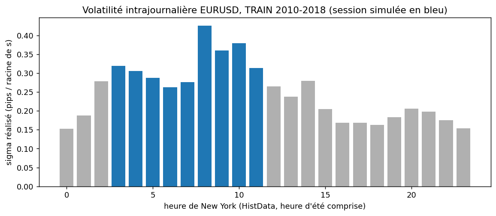

**Comment lire ce graphique.** Volatilité réalisée de l'EURUSD par heure de New York, mesurée sur TRAIN 2010-2018 (variations de close entre minutes consécutives). Les barres bleues sont les heures de la session simulée (03h-12h) : c'est leur moyenne en variance qui donne σ. La volatilité monte entre 02h et 03h (ouverture de Londres) et culmine entre 08h et 09h (annonces américaines de 8h30).

## Résultats détaillés

Tous les chiffres ci-dessous sont lus dans `results/verdict_mm.json` et `results/rejeu_variantes.json` (cette page est générée par `scripts/generer_readme.py`).

### Monte Carlo (2 000 sessions de 9 h par stratégie, graines communes)

| Stratégie | Sharpe annualisé | IC95 bootstrap | PnL moyen (pips x lot) | écart-type | P(perte) | CVaR 5 % | inventaire max (moy. / p95) | exécutions |
|---|---|---|---|---|---|---|---|---|
| Naïve symétrique | 7,0 | [6,3 ; 7,8] | 298 | 675 | 32,5 % | -1 128 | 20,0 / 20 | 2 325 |
| Avellaneda-Stoikov | 25,0 | [23,9 ; 26,0] | 302 | 192 | 5,7 % | -92 | 14,1 / 20 | 2 319 |
| AS skew plafonné | 24,7 | [23,7 ; 25,8] | 303 | 194 | 5,6 % | -95 | 14,2 / 20 | 2 315 |
| GLFT asymptotique | 36,0 | [34,8 ; 37,3] | 306 | 135 | 0,8 % | 40 | 7,9 / 9 | 2 320 |
| Placebo (cotes aléatoires) | 5,7 | [5,0 ; 6,4] | 246 | 687 | 36,2 % | -1 183 | 20,0 / 20 | 2 637 |

Sharpe journalier annualisé par √252 ; IC95 par bootstrap des sessions ; CVaR 5 % = moyenne des 5 % pires journées.
Décomposition du PnL moyen (pips x lot par session) :

| Stratégie | capture de spread | inventaire : diffusion | inventaire : sélection adverse | liquidation | frais | = PnL moyen |
|---|---|---|---|---|---|---|
| Naïve symétrique | 388 | -2 | -75 | -1,1 | -12 | 298 |
| Avellaneda-Stoikov | 387 | 0 | -72 | -0,8 | -12 | 302 |
| AS skew plafonné | 387 | 0 | -72 | -0,8 | -12 | 303 |
| GLFT asymptotique | 387 | 1 | -70 | -0,2 | -12 | 306 |
| Placebo (cotes aléatoires) | 311 | 33 | -85 | -1,0 | -13 | 246 |

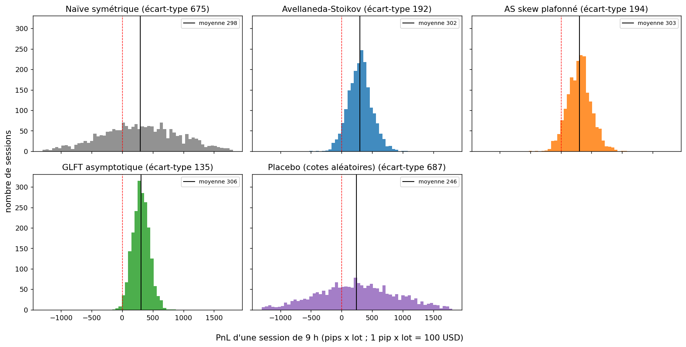

**Comment lire ce graphique.** Un histogramme par stratégie du PnL d'une session de 9 h (2 000 sessions, mêmes tirages pour toutes). Le trait noir est la moyenne, le pointillé rouge le zéro. Les moyennes sont presque égales ; ce qui change, c'est la largeur : le naïf et le placebo ont des queues de perte profondes, AS et GLFT sont resserrés autour de la moyenne.

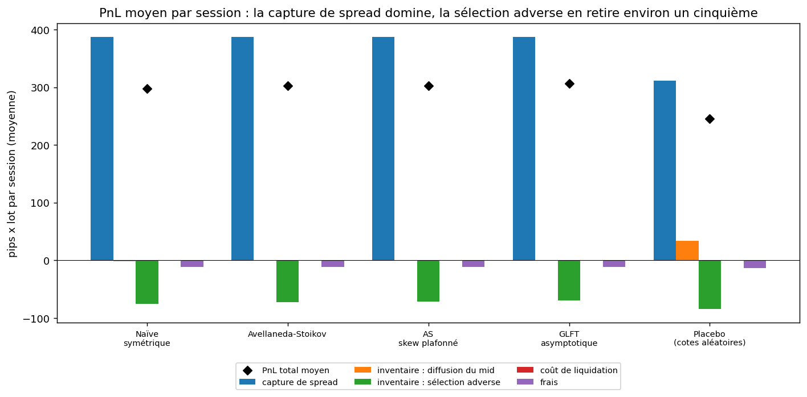

**Comment lire ce graphique.** Pour chaque stratégie, les composantes du PnL moyen par session (barres) et leur somme (losange noir). La capture de spread (la grande barre positive) est quasi identique partout ; la sélection adverse retire environ un cinquième ; la liquidation et les frais sont petits. Les stratégies ne diffèrent donc pas par ce qu'elles gagnent mais par le risque d'inventaire qu'elles portent.

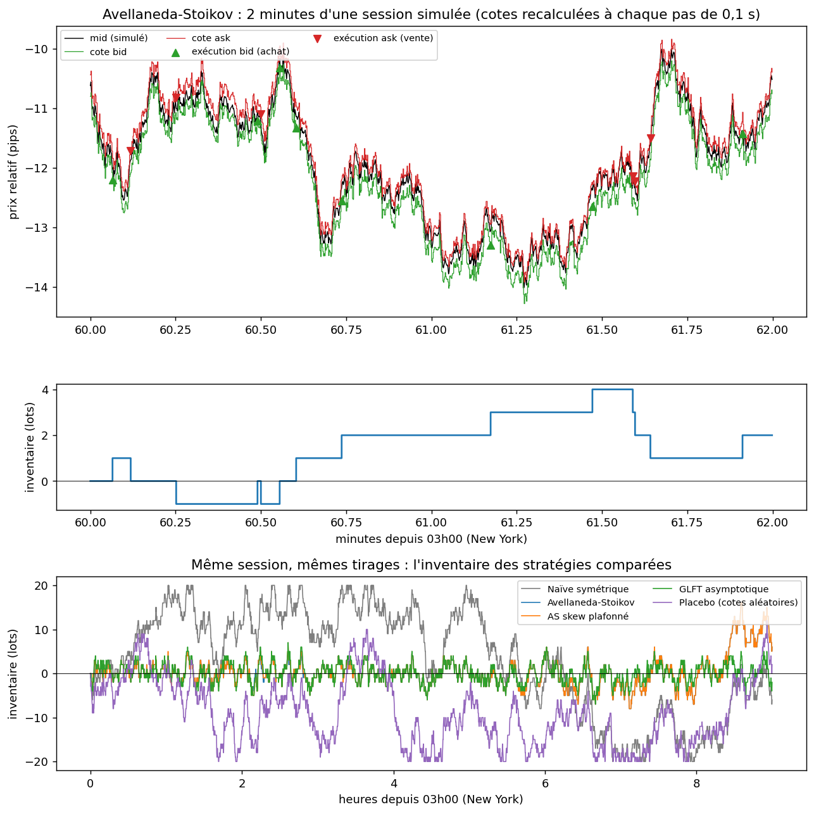

**Comment lire ce graphique.** Haut : deux minutes d'une session simulée d'AS, avec le mid, les cotes bid/ask (en escalier, car recalculées par pas de 0,1 s) et les exécutions (triangles). Milieu : l'inventaire correspondant. Bas : l'inventaire de la session entière pour les cinq stratégies, mêmes tirages ; le naïf et le placebo atteignent la borne de 20 lots (inventaire maximal moyen 20,0), AS et surtout GLFT la contiennent bien mieux (14,1 et 7,9 lots).

À lire : la **capture de spread est à peu près la même pour tout le monde** (mêmes clients) ; ce qui change, c'est le **risque** d'inventaire.
AS et GLFT divisent l'écart-type des sessions par 3 à 5 par rapport au naïf, d'où un Sharpe de simulation bien supérieur. Le **placebo**
(cotes aléatoires de même largeur) a un Sharpe de 5,7, comparable au naïf (7,0) : le gain d'AS/GLFT vient de la
logique d'inventaire, pas de la largeur des cotes. Mais **dans un monde simulé qui obéit exactement au modèle testé, cette supériorité est
une propriété de la simulation, pas une preuve de performance**.

### Rejeu sur barres 1 minute réelles, VAL 2019-2022 (1036 journées de Londres)

Règles (voir `mm/rejeu_reel.py`) : référence causale = close de la minute précédente (+ demi-spread de marché, HistData étant en BID) ; la
cote de la minute *i* n'utilise que des données ≤ *i*-1 (test de non-fuite : on modifie les barres futures, les cotes passées ne bougent pas) ;
le bid n'est exécuté que si la barre suivante **traverse** la cote. Trois modèles de fill : « toucher suffit », « traverser d'au moins 0,1 pip », « traverser de 0,1 pip **et**
tirer la probabilité de file f = 0,5 ».

**Si bid et ask sont tous deux atteints dans la même barre**, l'ordre intra-barre est inconnu. Deux lectures encadrent la vérité : **« côté perdant seul »** (seul le côté perdant est exécuté, lecture pessimiste)
ou **« les deux côtés »** (aller-retour à chaque barre, lecture optimiste). Le côté « perdant » est celui dont le **close de la barre** s'éloigne de la cote (`C - bid <= ask - C` dans `mm/rejeu_reel.py`) :
ce critère utilise une information postérieure à la pose des cotes, retournée contre la stratégie. C'est donc un **choix pessimiste fait a posteriori (un oracle adverse), pas une hypothèse de remplissage réaliste** :
le « cas de base » (probabiliste + côté perdant seul) est une borne basse volontairement punitive, qui n'estime pas le PnL d'un vrai market maker. Une lecture non biaisée demanderait des ticks bid/ask
ou un carnet L2 avec la position dans la file.

**Sharpe annualisé du rejeu selon le modèle de fill** (le message central de cette section) :

| modèle de fill (traversée, f) | bid ET ask touchés | Naïve | Avellaneda-Stoikov | AS skew plafonné | GLFT | Placebo |
|---|---|---|---|---|---|---|
| touche (0,0 pip, f = 1,00) | seul le côté perdant, choisi avec le close de la barre (pessimiste a posteriori) | -17,8 | -22,8 | -20,4 | -23,2 | -17,4 |
| touche (0,0 pip, f = 1,00) | les deux côtés (optimiste) | -5,5 | -13,5 | -13,3 | -16,2 | -5,9 |
| traversee (0,1 pip, f = 1,00) | seul le côté perdant, choisi avec le close de la barre (pessimiste a posteriori) | -17,6 | -22,4 | -20,4 | -22,9 | -17,5 |
| traversee (0,1 pip, f = 1,00) | les deux côtés (optimiste) | -7,9 | -17,5 | -17,0 | -20,9 | -8,4 |
| probabiliste (0,1 pip, f = 0,50) | seul le côté perdant, choisi avec le close de la barre (pessimiste a posteriori) | -10,9 | -14,6 | -12,9 | -15,0 | -10,6 |
| probabiliste (0,1 pip, f = 0,50) | les deux côtés (optimiste) | -3,4 | -6,6 | -5,8 | -7,1 | -3,6 |

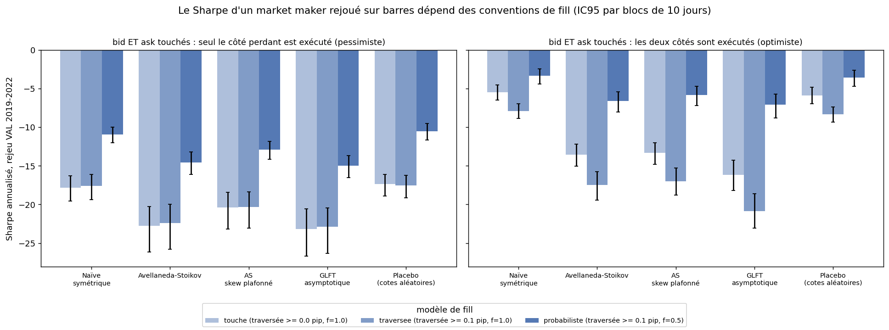

**Comment lire ce graphique.** Pour chaque stratégie (axe horizontal), trois barres = les trois modèles de fill (de plus en plus foncé : touche, traversée, probabiliste), avec leur IC 95 % par blocs de 10 jours. À gauche la convention « côté perdant seul », à droite « les deux côtés ». Toutes les barres sont sous zéro ; ce qui les fait varier, c'est le modèle de fill et la convention, pas la stratégie.

Trois constats.

1. **Aucune des six conventions ne donne un Sharpe positif** (de -23,2 à -3,4). La simulation, elle, donnait +7,0 à +36,0.
2. **Seule la probabilité de file f change vraiment le résultat.** Exiger une traversée de 0,1 pip plutôt que 0 est presque sans effet (voir la figure ci-dessous) : une barre d'une minute bouge d'environ 1,89 pips en VAL (2,55 avec le σ de TRAIN du simulateur), soit 11 à 15 demi-spreads, donc nos cotes sont
   traversées de toute façon. Plus f est grand, plus on est exécuté, donc plus on perd.
3. **Le classement en Sharpe s'inverse** : AS et GLFT font moins bien que le naïf sous les six conventions, alors qu'ils le dominaient en simulation.
   Deux effets mêlés, non démêlés : (i) quand l'espérance est négative, réduire la variance (ce que fait AS) rend le Sharpe plus négatif ; (ii) sous « deux côtés »,
   le PnL *moyen* d'AS est lui aussi plus bas. Hypothèse (non testée) pour (ii) : le décalage d'inventaire rapproche la cote du mid, donc sacrifie une partie de
   l'edge, pour un bénéfice de risque qui ne se paie pas quand chaque exécution est déjà adverse.

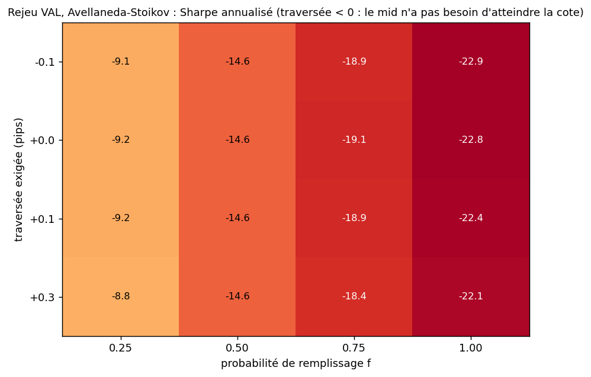

**Comment lire ce graphique.** Sharpe du rejeu d'AS pour chaque couple (probabilité de file f en abscisse, traversée exigée en ordonnée, de −0,1 à +0,3 pip ; une traversée négative n'exige même pas que le mid atteigne la cote). Les cases d'une même colonne sont presque identiques : le seuil compte peu, f décide.

Le cas de base, avec **IC95 par bootstrap en blocs de 10 jours** (les PnL journaliers réels peuvent être autocorrélés ; l'IC « iid » est donné pour comparaison) :

| Stratégie | Sharpe | IC95 par blocs de 10 j | IC95 iid (trop étroit) | PnL moyen / jour | exécutions / jour | inventaire max moyen |
|---|---|---|---|---|---|---|
| Naïve symétrique | -10,9 | [-12,0 ; -10,0] | [-12,0 ; -10,0] | -287 | 267 | 16,4 |
| Avellaneda-Stoikov | -14,6 | [-16,1 ; -13,2] | [-16,0 ; -13,3] | -287 | 267 | 13,0 |
| AS skew plafonné | -12,9 | [-14,2 ; -11,8] | [-14,1 ; -11,8] | -288 | 268 | 14,0 |
| GLFT asymptotique | -15,0 | [-16,5 ; -13,7] | [-16,4 ; -13,8] | -288 | 267 | 12,4 |
| Placebo (cotes aléatoires) | -10,6 | [-11,7 ; -9,5] | [-11,6 ; -9,5] | -279 | 266 | 16,3 |

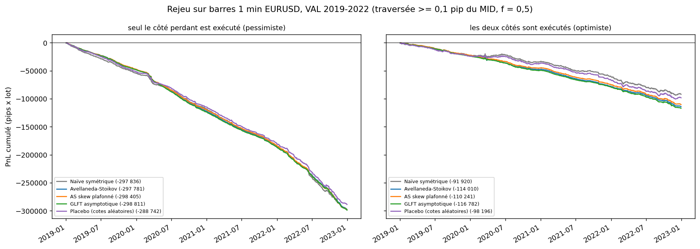

**Comment lire ce graphique.** PnL cumulé de chaque stratégie (en pips × lot, 100 USD par unité) dans le modèle de base, côté perdant seul à gauche et les deux côtés à droite ; le total final est dans la légende. Les cinq courbes sont quasi superposées et décroissent régulièrement (environ -287 pips x lot par jour dans le cas de base, côté perdant seul) : la perte ne vient
pas d'une période particulière mais de la convention elle-même. Pour l'échelle : les PnL en M USD des autres figures et du tableau de bord sont rapportés à un capital de référence arbitraire de 100 M USD (1 M USD = 1 %).

**Markout** : pour chaque exécution, (mid futur - prix d'exécution) x sens, à +1, +5 et +15 minutes (pips par exécution, ± IC95 ; modèle de base,
lecture « deux côtés » pour ne pas mélanger l'artefact du choix du côté perdant) :

| Stratégie | +1 min | +5 min | +15 min |
|---|---|---|---|
| Naïve symétrique | -0,27 ± 0,01 | -0,26 ± 0,01 | -0,27 ± 0,02 |
| Avellaneda-Stoikov | -0,28 ± 0,01 | -0,28 ± 0,01 | -0,28 ± 0,02 |
| AS skew plafonné | -0,27 ± 0,01 | -0,27 ± 0,01 | -0,28 ± 0,02 |
| GLFT asymptotique | -0,28 ± 0,01 | -0,28 ± 0,01 | -0,29 ± 0,02 |
| Placebo (cotes aléatoires) | -0,29 ± 0,01 | -0,28 ± 0,01 | -0,29 ± 0,02 |

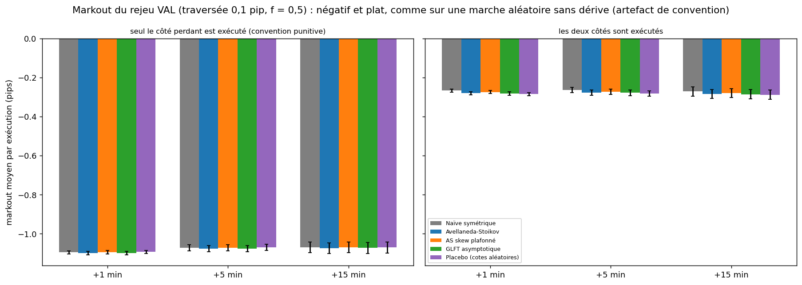

**Comment lire ce graphique.** Markout moyen par exécution à +1, +5 et +15 minutes (une barre par stratégie), avec son IC 95 %. Une sélection adverse « réelle » donnerait un markout de plus en plus négatif avec l'horizon ; ici les trois horizons sont au même niveau : rien ne suit l'exécution.

Le markout est négatif et **constant de +1 à +15 minutes** : rien ne « suit » l'exécution, le prix ne revient pas mais ne s'éloigne pas non plus. L'edge
théorique d'une exécution (le demi-spread posé, environ 0,17 pip) est pourtant plus que mangé, et **ce n'est pas une mesure de la sélection adverse du marché
réel** : une barre qui traverse notre cote est, par construction, une barre qui bouge, et l'exécution est comptée au prix de la cote alors que le prix a déjà
dépassé la cote (traversée exigée de 0,1 pip + dépassement à l'intérieur de la barre). Contrôle : le même rejeu appliqué à 400 journées d'une marche
aléatoire **sans dérive et sans sélection adverse**, de même sigma de minute que VAL (1,89 pips), donne des résultats du même ordre de grandeur (plus négatifs côté perdant seul, quasi identiques côté deux côtés) :

| bid ET ask touchés | Stratégie | PnL moyen/jour : barres réelles | PnL moyen/jour : marche aléatoire | markout +1 min : barres réelles | markout +1 min : marche aléatoire |
|---|---|---|---|---|---|
| seul le côté perdant | Naïve symétrique | -287 | -359 | -1,10 | -1,33 |
| seul le côté perdant | Avellaneda-Stoikov | -287 | -361 | -1,10 | -1,33 |
| les deux côtés | Naïve symétrique | -89 | -97 | -0,27 | -0,24 |
| les deux côtés | Avellaneda-Stoikov | -110 | -106 | -0,28 | -0,25 |

Le rejeu ne distingue donc pas l'EURUSD réel d'une marche aléatoire : son résultat mesure le coût de la **convention de fill**, pas une propriété de la microstructure réelle.
Il montre que la simulation (Sharpe positif) et le rejeu sur barres (Sharpe négatif) ne se comparent pas, pas que le marché réel punit ces stratégies.

**Placebo dans le rejeu** (30 graines de tirages, mêmes graines pour AS et pour le placebo ; cotes aléatoires de même largeur moyenne) :

| bid ET ask touchés | Sharpe AS | Sharpe placebo | PnL moyen/jour AS | PnL moyen/jour placebo | AS > placebo (Sharpe) | AS > placebo (PnL moyen) |
|---|---|---|---|---|---|---|
| seul le côté perdant | -14,7 | -10,6 (5e-95e pct : -11,2 ; -10,0) | -288 | -279 | 0 % des graines | 13 % des graines |
| les deux côtés | -7,0 | -4,1 (5e-95e pct : -4,8 ; -3,4) | -114 | -106 | 0 % des graines | 20 % des graines |

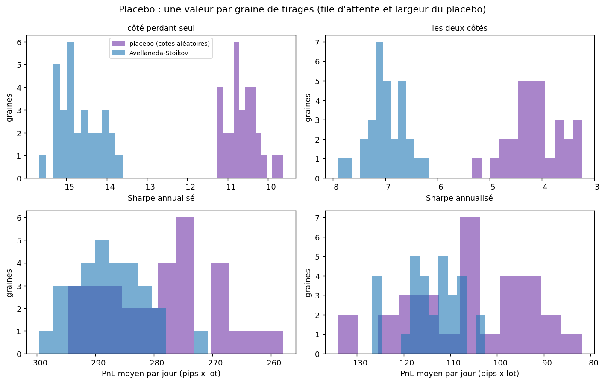

**Comment lire ce graphique.** Pour chaque lecture de « bid ET ask touchés » (une colonne), le Sharpe (haut) et le PnL moyen par jour (bas) obtenus pour chacune des 30 graines de tirage, pour AS (bleu) et pour le placebo (violet). Les deux distributions se chevauchent presque en PnL moyen (aucun avantage d'AS), alors que le Sharpe d'AS est systématiquement plus négatif (moins de variance).

Dans le rejeu, **AS n'a aucun avantage d'espérance sur des cotes tirées au hasard** : PnL moyen par jour de -288 contre -279
(côté perdant seul) et -114 contre -106 (deux côtés) ; AS ne fait mieux que le placebo dans 13 % et 20 %
des graines seulement. AS réduit bien la variance (écart-type journalier 313 contre 419 pips x lot dans le cas de base),
mais quand l'espérance est négative, **réduire la variance dégrade le Sharpe** : c'est pourquoi AS est plus négatif que le placebo en Sharpe dans 100 % des graines.
Comparer des Sharpe sans regarder les espérances aurait donné une conclusion trompeuse. La logique d'inventaire d'AS, précieuse dans le monde simulé, ne produit
aucun gain d'espérance sur ces barres.

## Pourquoi un Sharpe de simulation n'est pas un Sharpe de marché

Trois mécanismes, absents du modèle de base, sont chacun suffisants pour détruire le Sharpe simulé.

**Sélection adverse** : p = 0 → p = 0,4 fait passer AS de 31,4 à 19,2. La baisse est régulière mais modérée tant que
p·α (perte moyenne par exécution) reste sous le demi-spread.

| p (sélection adverse) | Naïve | Avellaneda-Stoikov | AS skew plafonné | GLFT | Placebo |
|---|---|---|---|---|---|
| 0,00 | 8,8 | 31,4 | 31,1 | 43,5 | 7,9 |
| 0,10 | 7,8 | 28,2 | 27,9 | 39,4 | 6,9 |
| 0,20 | 6,9 | 25,3 | 25,0 | 35,3 | 5,9 |
| 0,30 | 6,1 | 22,2 | 22,0 | 31,0 | 4,9 |
| 0,40 | 5,3 | 19,2 | 19,0 | 26,9 | 3,9 |

*Ce tableau vient de 500 sessions par cellule (graine 777) ; le tableau principal du Monte Carlo en a 2 000 (graine 20260713). À p = 0,2, AS vaut 25,0 dans le second et 25,3 ici, GLFT 36,0 contre 35,3 : deux jeux de tirages, écart compris dans les IC.*

**Latence (cotes périmées)** : le mid bouge de σ√(L·dt) entre deux mises à jour ; dès que ce mouvement dépasse le demi-spread, les cotes se font
« ramasser ». AS passe de 25,3 (100 ms) à -3,2 à 1 s et -99,2 à 60 s.

| délai entre deux mises à jour des cotes | Naïve | Avellaneda-Stoikov | AS skew plafonné | GLFT | Placebo |
|---|---|---|---|---|---|
| 100 ms | 6,9 | 25,3 | 25,0 | 35,3 | 5,9 |
| 200 ms | 5,5 | 21,3 | 21,0 | 27,6 | 4,1 |
| 500 ms | 2,9 | 9,7 | 9,6 | 12,9 | 1,6 |
| 1 s | -1,2 | -3,2 | -2,8 | -4,2 | -1,9 |
| 3 s | -11,0 | -25,9 | -23,2 | -33,9 | -11,4 |
| 10 s | -31,7 | -52,3 | -44,0 | -59,8 | -30,6 |
| 60 s | -85,1 | -99,2 | -91,3 | -101,2 | -84,4 |

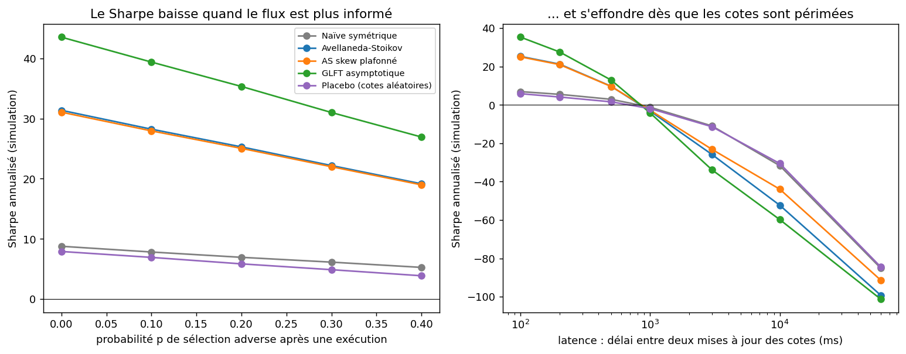

**Comment lire ce graphique.** Sharpe simulé de chaque stratégie quand on augmente la part de flux informé p (à gauche) puis le délai entre deux mises à jour des cotes (à droite, échelle logarithmique). Le Sharpe baisse doucement avec p, mais passe sous zéro entre 0,5 et 1 s de latence et devient très négatif à 60 s : le rejeu sur barres 1 minute est dans cette zone.

**Le rejeu sur barres 1 minute équivaut à coter avec 60 s de latence** : la cote posée au close précédent reste fixe pendant une minute où le prix bouge de
1,89 pips en VAL (2,55 avec le σ de TRAIN). Le rejeu tombe dans la zone « effondrée » de la figure ci-dessus : le simulateur prédit lui-même un Sharpe très négatif à 60 s,
donc le rejeu ne le contredit pas, il le confirme. Il ne peut donc **pas** valider un market maker à
haute fréquence ; il sert à mesurer l'écart avec la simulation et la sensibilité aux conventions de fill.

**Sensibilité aux hypothèses A, k et au gamma de la stratégie** (cases en gras = valeurs de base ; k réel ≠ k supposé par la stratégie) :

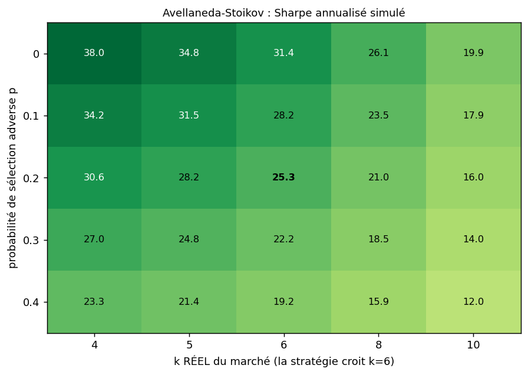

**Comment lire ce graphique.** Sharpe simulé d'AS pour chaque couple (k réel du marché en abscisse, probabilité de sélection adverse p en ordonnée) alors que la stratégie croit k = 6 ; la case en gras est le cas de base. Rouge = négatif, bleu = positif. Le Sharpe reste positif sur toute la grille (de 12,0 à 38,0) : p et k seuls n'expliquent pas le rejeu.

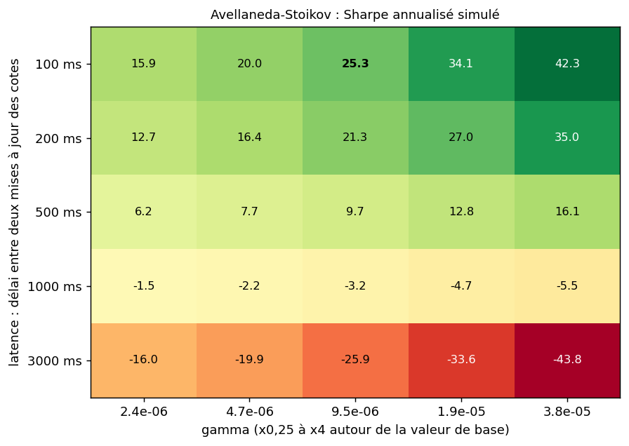

**Comment lire ce graphique.** Sharpe simulé d'AS selon le gamma de la stratégie (de ×0,25 à ×4, en abscisse) et la latence (en ordonnée). À faible latence, un gamma plus grand (plus de contrôle d'inventaire) augmente le Sharpe simulé ; à partir de 1 s de latence il est négatif quel que soit gamma : on ne rattrape pas des cotes périmées en ajustant l'aversion au risque.

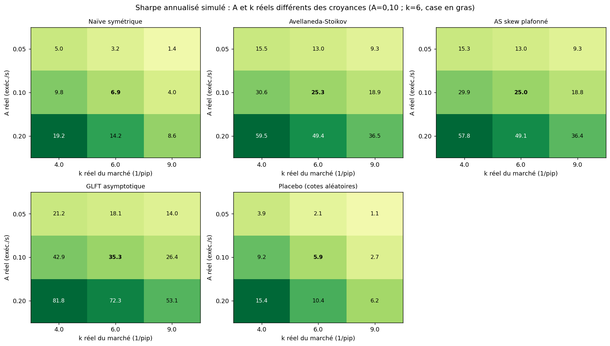

**Comment lire ce graphique.** Une grille 3×3 par stratégie : Sharpe simulé quand A (fréquence d'exécution) et k (sensibilité à la profondeur) réels diffèrent des croyances de la stratégie (case en gras = hypothèses de base). Les Sharpe changent d'ampleur (de 1,1 à 81,8 sur toute la grille et toutes les stratégies) mais restent positifs.

Ces grilles sont une **présentation de robustesse, pas une optimisation** : 3x3 pour A et k, 5x5 au plus pour les autres, et aucune valeur n'est
retenue en fonction du résultat.

## Validation et tests

70 tests collectés, quelques secondes (`python -m pytest -q`) ; certains lisent les données de marché locales et sont sautés sans elles. Chaque brique est confrontée à une réponse connue.

- **Comptabilité** : le PnL obtenu autrement (`cash + inventaire x mid - liquidation`) coïncide avec la somme des composantes à 1e-9, en simulation et dans le rejeu, pour toutes les stratégies et conventions.
- **Cas limites exacts** : avec σ = 0 et p = 0, le PnL est exactement (demi-spread posé) × (nombre d'exécutions) moins la liquidation ; l'inventaire ne dépasse jamais la borne Q ; mêmes graines = mêmes résultats, graines différentes = résultats différents.
- **Non-fuite** : modifier les barres futures ne change aucune cote passée du rejeu ; le TEST 2023+ lève `PermissionError` à la lecture.
- **Formules** : AS, GLFT, prix de réservation et constantes c1, c2 contre leurs expressions fermées ; σ retrouvé à quelques pour cent sur des barres synthétiques, sans fabriquer de volatilité avec les trous.
- **Rejeu** : fills (traversée de 0,1 pip, probabilité de file, ordre défavorable) vérifiés sur des barres écrites à la main ; markout recalculé à la main ; contrôle marche aléatoire (le markout négatif y apparaît déjà) ; fuseau (réouverture hebdomadaire à 17h00 en juillet comme en janvier, sur les données réelles).
- **Significativité** : PSR et DSR contre des valeurs connues (Sharpe nul, grand échantillon, nombre d'essais croissant).
- **Cohérence des sorties** : le PnL quotidien exporté redonne exactement le Sharpe de `results/verdict_mm.json` pour les 30 variantes ; `docs/data.json` est cohérent avec `results/` et ne contient aucune date ≥ 2023 ; les blocs de chiffres du README et cette page sont à jour ; le nombre de tests annoncé est exact ; les tableaux de plus de 7 colonnes du README sont repliés ; aucun lien de tableau de bord inexistant ; aucun chemin absolu de machine dans le dépôt (le dossier `.venv` éventuel est ignoré).
- **Données absentes** : sans les données HistData, les scripts de calcul s'arrêtent avec un message qui indique où les télécharger et l'arborescence attendue, sans trace d'erreur brute.
- **Contre-vérification du 13/10** par réimplémentation indépendante du rejeu : réimplémentation Python pure (mêmes exécutions et mêmes PnL en mode « deux côtés », à 4e-10), contrôle marche aléatoire ajouté après avoir montré que le markout négatif n'était pas une mesure de la sélection adverse, description du fuseau corrigée (aucun chiffre existant n'a changé).

## Positionnement face aux dépôts GitHub

D'après une recherche du 13/10/2026 (71 dépôts de market making, microstructure et exécution ; README lus, code non exécuté) :

| Dépôt | Ce que c'est | Ce que ce projet apporte en plus |
|---|---|---|
| [nkaz001/hftbacktest](https://github.com/nkaz001/hftbacktest) | backtester Rust/Numba sur carnet L2/L3 avec latence de flux, latence d'ordre et file d'attente | FX sur barres 1 min, markout, placebo, IC par blocs ; *eux* modélisent la file et la latence, *moi* je les traite en sensibilité |
| [JJJerome/mbt_gym](https://github.com/JJJerome/mbt_gym) | environnements gym vectorisés AS / Cartea-Jaimungal / exécution, avec solutions analytiques | calibration de σ sur données réelles, rejeu hors échantillon, split temporel strict |
| [cuemacro/tcapy](https://github.com/cuemacro/tcapy) | TCA FX spot (slippage, markout, benchmarks) | markout intégré à un simulateur de cotation (tcapy mesure, ne cote pas) |
| [nautechsystems/nautilus_trader](https://github.com/nautechsystems/nautilus_trader) | moteur événementiel de production, même code backtest/live, modèles de fill et de latence | périmètre volontairement réduit : le sujet ici est la validité du Sharpe, pas l'infrastructure |
| [abides-sim/abides](https://github.com/abides-sim/abides) | simulation multi-agents avec latences réseau | flux de fond synthétique remplacé par un modèle de flux informé à 2 paramètres (p, α) et des barres réelles |
| [fedecaccia/avellaneda-stoikov](https://github.com/fedecaccia/avellaneda-stoikov) | implémentation Python simple d'AS, fills de Poisson et paramètres (γ, σ, k) posés à la main, prix simulé | comparaison à GLFT, naïf et placebo ; sélection adverse et latence ; critère d'agressivité commun plutôt qu'un γ posé à la main (A et k sont aussi des hypothèses ici, mais avec grille de sensibilité) |
| [hummingbot/hummingbot](https://github.com/hummingbot/hummingbot) | framework de bots (pure MM, AS), orienté exploitation crypto, peu de mesure d'adverse selection d'après son README | markout par exécution et placebo ; pas de connecteurs ni de live |
| [DrAshBooth/PyLOB](https://github.com/DrAshBooth/PyLOB) | carnet d'ordres Python, hypothèse de latence nulle annoncée dans son README | latence et cotes périmées explicites |

Lacunes récurrentes relevées dans ces dépôts, que ce projet traite : latence et file d'attente absentes ou posées à la main ; fills « de Poisson » sans exiger que le
prix traverse la cote ; **pas de markout** (un seul dépôt sur la vingtaine de market making examinés l'annonce) ; pas de split TRAIN/VAL/TEST ni de validation sur données
réelles ; **pas d'IC ni de placebo**. Le FX est quasi absent de cet écosystème (le seul dépôt explicitement « FX market making » repéré a un README d'une ligne).
Ce que ce projet **n'a pas** : carnet L2, modèle de file d'attente, apprentissage par renforcement, code live, multi-actifs.

## English summary

> 1. FX market-making simulator (numba core, seeded `default_rng` draws): naive quotes, Avellaneda-Stoikov (2008), capped-skew AS, GLFT (2013), random-quote placebo.
> 2. Poisson fills A·exp(-k·δ), adverse-selection jumps, stale-quote latency; PnL split into spread capture / inventory / liquidation / fees, identity tested to 1e-9.
> 3. Monte Carlo (2 000 sessions, common random numbers): annualised Sharpe with bootstrap CIs; simulated Sharpe is high (AS 25,0) but collapses with adverse selection and latency.
> 4. Replayed on real EURUSD 1-minute bars (VAL 2019-2022, TEST sealed) under three fill models and two bid-and-ask conventions: Sharpe is negative everywhere (-23,2 to -3,4). All 30 variants (5 strategies x 3 fill models x 2 conventions) are published, with a PSR/DSR and an interactive dashboard.
> 5. Markout at +1/+5/+15 min is negative and flat, but a driftless random-walk control reproduces it (it measures the fill convention, not real adverse selection); a block-bootstrap CI and a placebo (random quotes) show AS has no edge over chance on bars.
> 6. Take-away: a simulated Sharpe is an upper bound, not a market Sharpe. The "loser side" convention uses the bar's close, a pessimistic choice made after the fact, not a realistic fill. Limits: A, k, p, α are assumptions (no order data); 1-minute bars imply ~60 s quote refresh; no L2 book or queue model.
